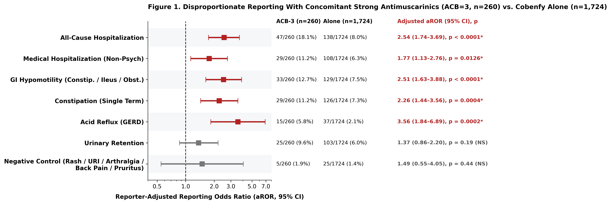
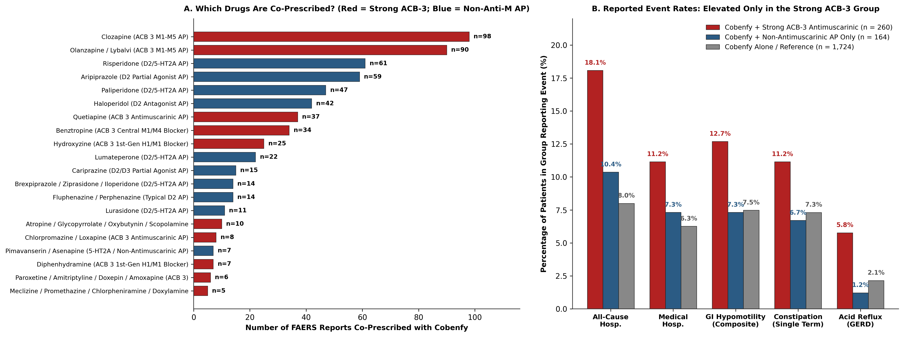

# APA 2027 New Research Poster Submission & READUS-PV Study Package

> **Submission Track:** APA 2027 Annual Meeting (May 1–5, 2027, New York City, Javits Center) — *New Research Poster Session*
> **Submission Window:** Opens November 12, 2026 | **Closes Friday, January 8, 2027 (5:00 p.m. ET)**
> **Author:** Harman Brah, MD
> **Reporting Standard:** Compliant with the 2024 **READUS-PV** Guideline (*Drug Safety* 2024, PMID: 38713346)
> **Back-Pocket Supplement:** Extended 15-endpoint sensitivity matrix, negative control outcomes, and sex/age demographic tables are archived in [SUPPLEMENT_AND_DEMOGRAPHICS.md](SUPPLEMENT_AND_DEMOGRAPHICS.md).

---

## 1. APA 2027 Abstract (Under 3,000 Characters with Spaces)

### Poster Title
**Concomitant Antimuscarinic Burden and Gastrointestinal Hypomotility Reporting with Xanomeline-Trospium in the FDA Adverse Event Reporting System**
*(Character count: 144 / 150 limit)*

### Structured Abstract
*(Character count: 2,837 with section labels / 2,795 without labels — under the 3,000-character APA limit)*

**Background:** Xanomeline-trospium (Cobenfy) pairs a central M1/M4 muscarinic agonist with a peripheral antimuscarinic (trospium) to limit cholinergic adverse events. Although approved as monotherapy, patients often receive concomitant antipsychotics (APs) or anticholinergics during cross-titration or augmentation. Whether concomitant strong antimuscarinics are associated with disproportionate reporting of gastrointestinal (GI) hypomotility and hospitalization in FAERS is unknown.

**Methods:** Following 2024 READUS-PV guidelines, we queried U.S. FAERS via OpenFDA through Q2 2026 for unique xanomeline-trospium reports and stratified them by Anticholinergic Cognitive Burden (ACB): Stratum 1, strong antimuscarinics (ACB=3: clozapine, olanzapine, quetiapine, chlorpromazine, loxapine, 1st-gen H1 blockers, benztropine, glycopyrrolate, oxybutynin, ACB-3 antidepressants); Stratum 2, non-antimuscarinic D2/5-HT2A APs only (risperidone, paliperidone, aripiprazole, haloperidol, lumateperone, cariprazine, lurasidone, fluphenazine); and an unexposed Reference. We estimated crude reporting odds ratios (ROR), logistic regression aRORs adjusted for healthcare-professional (HCP) vs. consumer reporter, and HCP-only and non-clozapine sensitivity models. Prespecified negative control outcomes (rash, upper respiratory infection, arthralgia, back pain, pruritus) tested for nonspecific reporting.

**Results:** Among 2,148 unique reports, 424 (19.7%) listed concomitant APs or ACB-3 drugs: Stratum 1 (n=260; 85.4% HCP), Stratum 2 (n=164; 79.3% HCP), and Reference (n=1,724; 51.3% HCP). Versus Reference, Stratum 1 had consistently higher reporting odds across crude, adjusted, HCP-only, and non-clozapine models for all-cause hospitalization (18.1% vs. 8.0%; aROR 2.54, 95% CI 1.74-3.69, p<0.0001; HCP ROR 2.23; non-clozapine ROR 2.30), composite GI hypomotility (12.7% vs. 7.5%; aROR 2.51, 1.63-3.88, p<0.0001; HCP ROR 3.17), constipation (11.2% vs. 7.3%; aROR 2.26, p=0.0004), and GERD (5.8% vs. 2.1%; aROR 3.56, p=0.0002; non-clozapine ROR 3.98). Medical (non-psychiatric) hospitalization was elevated after adjustment (aROR 1.77, p=0.013) but not in the non-clozapine model. Urinary retention attenuated after adjustment (aROR 1.37, p=0.19). Stratum 2 showed no disproportionality for hospitalization (aROR 1.33, p=0.30), GI hypomotility (aROR 1.24, p=0.51), or GERD (aROR 0.67, p=0.59). Negative controls showed no Stratum 1 signal (1.9% vs. 1.5%; aROR 1.49, 0.55-4.05).

**Conclusion:** Nearly 1 in 5 xanomeline-trospium FAERS reports lists concomitant APs or strong antimuscarinics. Concomitant ACB-3 agents, but not non-antimuscarinic APs, were associated with disproportionate reporting of GI hypomotility, GERD, and hospitalization. These signals support caution with anticholinergic co-prescribing and warrant confirmation in longitudinal data.

---

## 2. Figures

---

## 3. Core Summary Table: Concomitant Antimuscarinic Burden ($N = 2,148$)

| Clinical Outcome | Strong ACB-3 ($n = 260$) | Non-Anti-M AP ($n = 164$) | Reference ($n = 1,724$) | Stratum 1 Crude ROR (95% CI), $p$ | Stratum 1 Reporter-Adjusted aROR (95% CI), $p$ | Stratum 1 HCP-Only ROR ($n=222$ vs. $885$), $p$ | Stratum 1 Non-Clozapine ROR ($n=162$ vs. $1,724$), $p$ | Stratum 2 Reporter-Adjusted aROR (95% CI), $p$ |
| :--- | :---: | :---: | :---: | :---: | :---: | :---: | :---: | :---: |
| All-Cause Hospitalization | 47 (18.1%) | 17 (10.4%) | 138 (8.0%) | **2.54 (1.77–3.64)**, $p < 0.0001$ | **2.54 (1.74–3.69)**, $p < 0.0001$ | **2.23 (1.46–3.40)**, $p = 0.0003$ | **2.30 (1.47–3.60)**, $p = 0.0007$ | 1.33 (0.78–2.28), $p = 0.30$ |
| Medical Hospitalization *(Non-Psych)* | 29 (11.2%) | 12 (7.3%) | 108 (6.3%) | **1.88 (1.22–2.89)**, $p = 0.0057$ | **1.77 (1.13–2.76)**, $p = 0.0126$ | **1.79 (1.10–2.91)**, $p = 0.0247$ | 1.53 (0.87–2.69), $p = 0.14$ | 1.13 (0.60–2.11), $p = 0.71$ |
| GI Hypomotility *(Constip./Ileus/Obst.)* | 33 (12.7%) | 12 (7.3%) | 129 (7.5%) | **1.80 (1.20–2.70)**, $p = 0.0071$ | **2.51 (1.63–3.88)**, $p < 0.0001$ | **3.17 (1.89–5.34)**, $p < 0.0001$ | **1.84 (1.13–3.01)**, $p = 0.0214$ | 1.24 (0.66–2.31), $p = 0.51$ |
| Constipation *(Single MedDRA PT)* | 29 (11.2%) | 11 (6.7%) | 126 (7.3%) | **1.59 (1.04–2.44)**, $p = 0.0353$ | **2.26 (1.44–3.56)**, $p = 0.0004$ | **3.03 (1.76–5.23)**, $p = 0.0001$ | **1.89 (1.15–3.09)**, $p = 0.0141$ | 1.17 (0.61–2.24), $p = 0.64$ |
| Gastroesophageal Reflux (GERD) | 15 (5.8%) | 2 (1.2%) | 37 (2.1%) | **2.79 (1.51–5.16)**, $p = 0.0025$ | **3.56 (1.84–6.89)**, $p = 0.0002$ | **3.24 (1.45–7.25)**, $p = 0.0086$ | **3.98 (2.07–7.65)**, $p = 0.0002$ | 0.67 (0.16–2.83), $p = 0.59$ |
| Urinary Retention | 25 (9.6%) | 9 (5.5%) | 103 (6.0%) | **1.67 (1.06–2.65)**, $p = 0.0303$ | 1.37 (0.86–2.20), $p = 0.19$ | 1.41 (0.86–2.32), $p = 0.17$ | **2.34 (1.42–3.86)**, $p = 0.0023$ | 0.78 (0.39–1.59), $p = 0.50$ |
| Negative Control Composite *(Rash/URI/Arthralgia/Back Pain/Pruritus)* | 5 (1.9%) | 7 (4.3%) | 25 (1.5%) | 1.33 (0.51–3.51), $p = 0.58$ | 1.49 (0.55–4.05), $p = 0.44$ | 0.92 (0.26–3.25), $p = 1.00$ | — | **3.29 (1.37–7.89)**, $p = 0.0077$ |

*Stratum 2 (non-antimuscarinic APs) shows no disproportionality on any GI or hospitalization outcome, so the GI signal tracks antimuscarinic burden rather than antipsychotic co-prescribing in general. The negative control composite is null for Stratum 1 but elevated for Stratum 2 (driven by 4 rash and 1 each of arthralgia, back pain and pruritus reports out of 164). Negative control events are sparse (37 across all strata), so these checks have limited power.*

---

## 4. Exploratory: Long-Acting Injectable (LAI) vs. Oral Antipsychotics (Not in Abstract)

LAI status is taken from the product name the reporter entered (e.g., INVEGA SUSTENNA, ABILIFY MAINTENA, RISPERDAL CONSTA). The earlier version also used OpenFDA brand lists, which attach every LAI brand to the molecule, so 70 reports of plain oral risperidone, olanzapine or aripiprazole were counted as LAI. With the corrected definition, $n = 49$ LAI vs. $n = 354$ non-LAI among 403 AP-cotreated reports.

| Comparison | LAI AP | No LAI (oral) AP | ROR (95% CI), $p$ | HCP-Only |
| :--- | :---: | :---: | :---: | :---: |
| GI Hypomotility, all AP-cotreated reports | 4/49 (8.2%) | 39/354 (11.0%) | 0.72 (0.24–2.10), $p = 0.80$ | 0.69 (0.20–2.36), $p = 0.78$ |
| GI Hypomotility, Stratum 2 only (same antimuscarinic burden) | 3/31 (9.7%) | 9/133 (6.8%) | 1.48 (0.38–5.81), $p = 0.70$ | — |
| GERD, all AP-cotreated reports | 0/49 (0.0%) | 16/354 (4.5%) | 0 events, $p = 0.24$ | 0 events, $p = 0.37$ |
| GERD, Stratum 2 only | 0/31 (0.0%) | 2/133 (1.5%) | 0 events, $p = 1.00$ | — |
| All-Cause Hospitalization, all AP-cotreated reports | 10/49 (20.4%) | 50/354 (14.1%) | 1.56 (0.73–3.32), $p = 0.28$ | 1.12 (0.44–2.84), $p = 0.81$ |

The earlier "3.4-fold lower GI hypomotility with LAI" result does not hold. LAI and oral reports also differ in antimuscarinic burden (18/49 LAI vs. 221/354 oral reports are in Stratum 1), and within Stratum 2 there is no difference. Within-molecule comparisons (e.g., LAI vs. oral aripiprazole, $n = 12$ LAI) are too small to interpret. Route is reported as a limitation, not a finding.

---

## 5. Negative Control Outcomes (Prespecified)

| Negative Control Outcome | Stratum 1 | Stratum 2 | Reference | Stratum 1 aROR (95% CI), $p$ | Stratum 2 aROR (95% CI), $p$ |
| :--- | :---: | :---: | :---: | :---: | :---: |
| Negative Control Composite (Any of 5) | 5/260 | 7/164 | 25/1724 | 1.49 (0.55–4.05), $p = 0.44$ | **3.29 (1.37–7.89)**, $p = 0.0077$ |
| Rash | 3/260 | 4/164 | 16/1724 | 1.02 (0.29–3.61), $p = 0.97$ | 2.29 (0.75–7.05), $p = 0.15$ |
| Upper Respiratory Infection | 0/260 | 0/164 | 2/1724 | too few events to model | too few events to model |
| Arthralgia | 0/260 | 1/164 | 1/1724 | too few events to model | too few events to model |
| Back Pain | 1/260 | 1/164 | 0/1724 | too few events to model | too few events to model |
| Pruritus | 1/260 | 1/164 | 6/1724 | 1.59 (0.17–14.47), $p = 0.68$ | 2.28 (0.26–19.84), $p = 0.46$ |

---

## 6. Key Takeaways & Methodological Scope (READUS-PV 2024)

1. **Strong ACB-3 co-prescribing:** Reports listing a strong antimuscarinic (`ACB = 3`, $n = 260$) alongside Cobenfy's peripheral trospium component had higher reporting odds of GI hypomotility (`aROR 2.51, p < 0.0001`), GERD (`aROR 3.56, p = 0.0002`), and hospitalization (`aROR 2.54, p < 0.0001`) than reports without concomitant APs or ACB-3 drugs.
2. **Non-antimuscarinic antipsychotics:** Reports listing only non-antimuscarinic D2/5-HT2A APs (`Stratum 2, n = 164`) showed no disproportionate reporting of GI hypomotility (`7.3% vs. 7.5%`, `aROR 1.24, p = 0.51`), GERD (`1.2% vs. 2.1%`), or hospitalization (`aROR 1.33, p = 0.30`). This contrast is consistent with, but does not prove, an antimuscarinic mechanism.
3. **Route of administration:** After correcting LAI classification, LAI vs. oral AP route showed no difference in GI hypomotility or GERD reporting (Section 4).
4. **READUS-PV Guardrails:** FAERS is a spontaneous reporting system without a population denominator. These results describe disproportionate reporting, not incidence or causation. They cannot separate additive from supra-additive (synergistic) drug effects, and confounding by indication (e.g., treatment-resistant illness in clozapine users) and channelling bias remain possible.

---

## 5. Verified References (PubMed Checked)

1. **Fusaroli M, Salvo F, Begaud B, et al.** The REporting of A Disproportionality analysis for drUg Safety signal detection using individual case safety reports in PharmacoVigilance (READUS-PV): development and statement. *Drug Saf.* 2024;47(6):575–584. PMID: 38713346.
2. **Brannan SK, Sawchak S, Miller AC, Lieberman JA, Paul SM, Breier A.** Muscarinic cholinergic receptor agonist and peripheral antagonist for schizophrenia. *N Engl J Med.* 2021;384(8):717–726. PMID: 33626254.
3. **Kaul I, Sawchak S, Correll CU, Kakar R, Breier A, Paul SM, Brannan SK.** Efficacy and safety of the muscarinic receptor agonist KarXT (xanomeline-trospium) in schizophrenia (EMERGENT-2) in the USA: results from a randomised, double-blind, placebo-controlled, flexible-dose phase 3 trial. *Lancet.* 2024;403(10422):160–170. PMID: 38104575.
4. **Kaul I, Claxton A, Sawchak S, Sauder C, Brannan SK.** Safety and tolerability of xanomeline and trospium chloride in schizophrenia: pooled results from the 5-week, randomized, double-blind, placebo-controlled EMERGENT trials. *J Clin Psychiatry.* 2025;86(1):24m15497. PMID: 40047530.
5. **Song X, Feng T, Lin H, Qian H.** A real-world pharmacovigilance study of Xanomeline-Trospium events in the FDA adverse event reporting system (FAERS). *Psychiatry Res.* 2026;361:117162. PMID: 41985280.
6. **Zeng Y, Wang X, Wu H, Tan X.** Post-marketing safety surveillance of the novel muscarinic antipsychotic Xanomeline-Trospium for schizophrenia: a comparative disproportionality analysis against olanzapine based on FAERS data. *Psychiatry Res.* 2026;364:117270. PMID: 42288069.
7. **Aboukaoud M, Amiaz R, Hoch B, Davidson M.** Xanomeline/trospium and suicide-related events in schizophrenia: an early pharmacovigilance analysis. *Schizophr Res.* 2026;295:146–149. PMID: 42250381.
8. **Bao Z, Liu Y, Liu Y.** Safety profile and potential clinical risks of xanomeline and trospium chloride: a real-world pharmacovigilance study using FAERS. *Neurotherapeutics.* 2026;23:e00930. PMID: 42202430.
